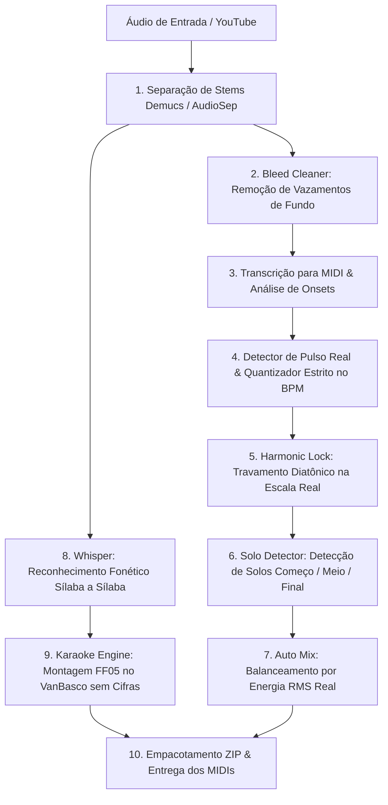

# MidiDream 

> ** VERSÃO ALPHA EM TESTES E DESENVOLVIMENTO ATIVO**  
> O **MidiDream** está atualmente em estágio **Alpha**. Novos recursos, calibrações de inteligência musical e melhorias de precisão rítmica e harmônica estão sendo implementados e validados constantemente.

---

##  O que é o MidiDream? (O que faz)

O **MidiDream** é uma estação de trabalho inteligente projetada para transformar qualquer música — seja através de arquivos de áudio (`.mp3`, `.wav`, `.flac`, `.m4a`) ou via **links do YouTube** — em arranjos **MIDI multipista profissionais** e arquivos de **Karaokê sincronizados (`.kar` e `.mid`)** prontos para reprodução no **VanBasco**, sintetizadores General MIDI, teclados arranjadores e softwares de produção musical (DAWs).

### Principais Entregas do Sistema:
- **`karaoke.kar` & `karaoke.mid`**: Karaokê com letra sílaba por sílaba sincronizada no tempo exato do canto, com texto codificado em Latin-1 para total compatibilidade com acentos do português no VanBasco. Cifras de acordes são automaticamente reconhecidas e ocultadas da tela da letra.
- **`piano_solo.mid` (PianoSolo)**: Faixa e canal MIDI dedicados com a **função única e exclusiva de solar**. O MidiDream detecta automaticamente solos no **Começo** (Introdução), no **Meio** (Interlúdios e pausas instrumentais) e no **Final** (Solo de encerramento).
- **`piano.mid` (Piano Base)**: Acompanhamento harmônico e rítmico limpo, com notas de solo desmembradas para não embolar nem disputar espaço com o solo.
- **`drums.mid` & `hihat.mid`**: Bateria completa quantizada na métrica do BPM, com separação de peças (bumbo, caixa, tons, surdo, chimbal aberto/fechado e pratos de ataque/condução).
- **`bass.mid`**: Linha de contrabaixo com afinação da fundamental e sustentação contínua de groove (legato firme).
- **`guitar.mid`**: Violão e guitarra com palhetadas e dedilhados rítmicos.
- **`other.mid`**: Camas de teclados secundários, sintetizadores, cordas e pads.
- **`completo.mid` & `instrumental.mid`**: Arranjos consolidados com todos os instrumentos balanceados em seus respectivos canais General MIDI padrão.
- **Pacote `.zip` de entrega**: Download completo em um clique com todos os MIDIs, relatórios e áudio processado.

---

##  Como o MidiDream Funciona? (Arquitetura e Processamento)

O MidiDream opera através de uma pipeline modular de alta fidelidade:



### 1. Separação Acústica e Limpeza de Vazamentos
- Utiliza redes neurais profundas de ponta (**Demucs v4** / **AudioSep**) para desmembrar o áudio estéreo em stems isolados: bateria, baixo, vocais, guitarra, piano e outros.
- O módulo [`bleed_cleaner.py`](file:///c:/Users/Desktop/Desktop/Projeto%20MidiDream/programa/bleed_cleaner.py) analisa correlações espectrais cruzadas para eliminar instrumentos secundários que vazaram no fundo de outras faixas.

### 2. Medição do Andamento Real e Quantização Estrita no BPM
- Em vez de arredondar arbitrariamente, o [`bpm_detector.py`](file:///c:/Users/Desktop/Desktop/Projeto%20MidiDream/programa/bpm_detector.py) calcula a autocorrelação espectral de transientes e o pulso rítmico real da música.
- O [`midi_timing.py`](file:///c:/Users/Desktop/Desktop/Projeto%20MidiDream/programa/midi_timing.py) crava $100\%$ dos eventos de ataque e corte no grid exato de ticks do metrônomo (semínimas, colcheias e semicolcheias), eliminando desvios temporais e notas fora de tempo.

### 3. Travamento Harmônico Diatônico (Harmonic Lock)
- O [`music_guide.py`](file:///c:/Users/Desktop/Desktop/Projeto%20MidiDream/programa/music_guide.py) infere a tonalidade exata da música entre as 24 tonalidades maiores e menores padrão através de um algoritmo de pontuação com penalização severa para notas fora da escala.
- O [`harmonic_lock.py`](file:///c:/Users/Desktop/Desktop/Projeto%20MidiDream/programa/harmonic_lock.py) preserva integralmente as notas da escala e das melodias originais, corrigindo apenas notas estranhas causadas por ruídos ou harmônicos espúrios, eliminando qualquer sensação de desafinação.

### 4. Detecção e Isolamento Inteligente de Solos (PianoSolo)
- O [`solo_detector.py`](file:///c:/Users/Desktop/Desktop/Projeto%20MidiDream/programa/solo_detector.py) delimita os três momentos fundamentais de solo na música:
  - **No Começo**: Da abertura instrumental ($0.0\text{s}$) até a entrada da primeira frase cantada.
  - **No Meio**: Durante pausas vocais instrumentais ($\ge 2.5\text{s}$) e seções marcadas de solo/interlúdio.
  - **No Final**: A partir do encerramento da última palavra cantada até o término da música.
- Separa a linha melódica superior para a faixa **"Piano Solo"** no canal MIDI dedicado (Canal 8 / Canal 9 GM).
- Mantém o `PianoSolo` em silêncio absoluto durante o canto e remove as notas soladas do `piano.mid` de base, garantindo que base e solo nunca se misturem nem soem embolados.

### 5. Sincronização Fonética de Karaokê com Ocultação de Cifras
- Utiliza o **OpenAI Whisper** para reconhecimento acústico no nível de palavra e sotaque brasileiro.
- O [`karaoke_sync.py`](file:///c:/Users/Desktop/Desktop/Projeto%20MidiDream/programa/karaoke_sync.py) e [`lyrics.py`](file:///c:/Users/Desktop/Desktop/Projeto%20MidiDream/programa/lyrics.py) fatiam as palavras em sílabas poéticas, alinhando-as aos ataques vocais.
- Linhas e marcadores de cifras (como `Bm`, `G`, `A`, `[Intro]`, `[Solo]`) são identificados e removidos da exibição da letra no karaokê, exibindo exclusivamente os versos cantados.

### 6. Mixer Automático de Volumes (Auto Mix)
- O [`auto_mix.py`](file:///c:/Users/Desktop/Desktop/Projeto%20MidiDream/programa/auto_mix.py) mede a energia ativa RMS de cada stem e ajusta os controladores `Control Change 7` e velocities para reproduzir o equilíbrio da mixagem original.
- Possui controle inteligente para rebaixar automaticamente o segundo piano/pad de fundo e dar destaque total ao solo e à melodia principal.

---

##  Como Executar o Projeto

### Pré-requisitos:
- Sistema Operacional: **Windows 10 / 11**
- **Python 3.10 ou 3.11** instalado no ambiente do usuário.
- **FFmpeg** configurado no PATH ou na pasta `ferramentas/`.

### Inicialização Rápida:
1. Abra o terminal na pasta raiz do projeto:
   ```powershell
   cd "C:\Users\Desktop\Desktop\Projeto MidiDream"
   ```
2. Inicie a interface visual:
   ```powershell
   .\MidiDream.exe
   ```
   *Ou diretamente via Python:*
   ```powershell
   python programa/app.py
   ```
3. A interface web interativa abrirá automaticamente no navegador em `http://localhost:8501`.

---

##  Mapa dos Canais MIDI Padrão (GM)

| Canal (0-based) | Canal VanBasco | Instrumento | Função no Arranjo |
|:---:|:---:|:---|:---|
| **0** | **Canal 1** | Acoustic Bass | Condução rítmica e peso harmônico |
| **1** | **Canal 2** | Choir Aahs / Vocal | Guia melódica vocal |
| **2** | **Canal 3** | Acoustic Grand Piano | Piano de base e marcação harmônica rítmica |
| **3** | **Canal 4** | Steel Guitar / Violão | Acompanhamento rítmico |
| **4** | **Canal 5** | Synth Pad / Other | Cama harmônica e ambiência |
| **8** | **Canal 9** | Bright Piano (Piano Solo) | **Solos exclusivos (Começo, Meio e Fim)** |
| **9** | **Canal 10** | Standard Drum Kit | Bateria completa (bumbo, caixa, pratos, chimbal) |

---

##  Tecnologias Utilizadas

- **Linguagem**: Python 3.11
- **Processamento de Áudio**: Librosa, SoundFile, NumPy, SciPy
- **Modelos de IA**: Demucs v4 (Meta AI), AudioSep, OpenAI Whisper
- **Manipulação MIDI**: Mido, PrettyMIDI
- **Interface Gráfica**: Streamlit
- **Download & Integração**: yt-dlp, FFmpeg

---

##  Status: Versão Alpha
*Projeto sob autoria de Gabriel Simão. Código proprietário e privado para pesquisa e desenvolvimento em inteligência musical e processamento de áudio digital.*
